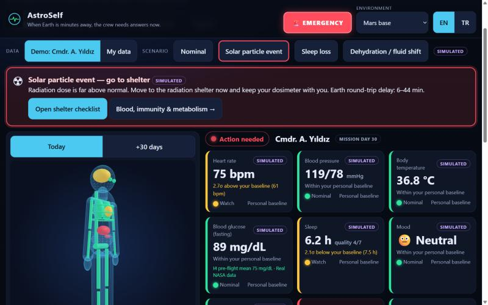
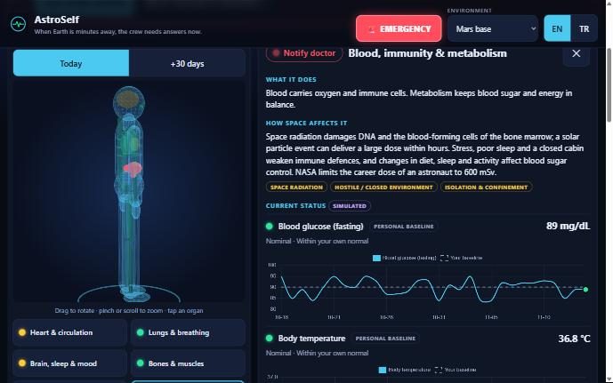
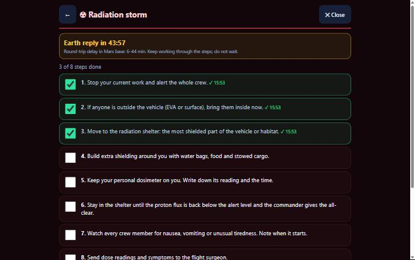
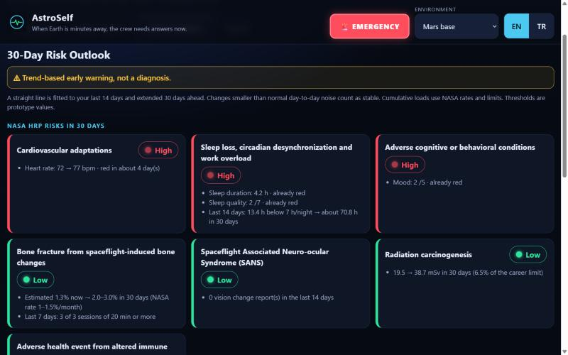

# AstroSelf — Astronaut Health Monitor

> *"When Earth is minutes away, the crew needs answers now."*

**Live demo:** https://senadogann.github.io/astro-health/ (no login, works offline after the first visit)

NASA Space Apps Challenge 2026 · Bursa · Team **İstikbal Göklerdedir**
Challenge: [Create Health Monitoring Software for Astronauts on Space Missions](https://www.spaceappschallenge.org/2026/challenges/health-monitoring-software/)

> **Prototype — not a medical device.** Prototype values. Real medical thresholds are set by flight surgeons.
> The app gives no diagnosis and no medication doses.



## The problem

In January 2026 a crew returned early from the ISS for a medical reason, because the equipment on board was not
enough for a full diagnosis. On the way to Mars there is no early return, and a message to Earth and back can take
up to 44 minutes. NASA's Exploration Medical Capability element lists Earth-independent medical decision support as
an open gap (ExMC Med07 / Med10).

## Our solution

AstroSelf is a visual self-assessment tool that an astronaut can use alone, without a connection to Earth.

- **Daily check-in** of heart rate, blood pressure, body temperature, blood glucose, sleep, mood (plus optional
  vision change and exercise), with a "How to measure?" help text for each one.
- **Assessment engine** with three layers: a *personal baseline* (mean and standard deviation of the first 7–14 days,
  z-score), *Earth reference* ranges, and *NASA-derived* limits. Every indicator and body system is green, yellow or red,
  and the app says why.
- **3D anatomy model** (Z-Anatomy, CC BY-SA 4.0) that can be rotated and zoomed, with switchable layers. Six systems
  (heart, lungs, brain, bones and muscles, eyes, blood and immunity) change colour with their status and pulse when red.
- **Organ panel**: what the system does, how the five hazards of spaceflight affect it, current values with trend
  charts, what to do, **when to notify the flight surgeon**, and the communication delay.
- **Environment selector**: ISS, Orion, lunar base, Mars transit, Mars base. It changes the communication delay,
  the radiation dose rate and the advice.
- **Real NASA data**: Inspiration4 blood values for comparison, and live space weather that raises a shelter alert.
- **Emergency mode** on every screen: six offline checklists, an "Earth reply in X min" countdown and a report for
  the flight surgeon.
- **30-day risk outlook**: trends and cumulative loads mapped to NASA HRP risks as Low / Medium / High, with a
  "Today / +30 days" switch on the 3D body.
- Reminders, a check-in streak with badges, and a printable one-page report.
- English and Turkish. Installable (PWA) and fully usable with no internet.

| Organ panel | Emergency checklist | 30-day outlook |
|---|---|---|
|  |  |  |

## How to use it

1. Open the [live demo](https://senadogann.github.io/astro-health/). It starts in **demo mode** with a fictional
   four-person crew and 180 days of **simulated** data (see "Simulated crew data" below).
2. Drag the **mission day** slider: the 3D body and the cards show the selected astronaut as they were on that day.
   Try day 118–126 for MS1 D. Aydın (a week of short sleep).
3. Open **Crew** to see the four astronauts side by side on the same day; "Open in dashboard" selects one.
4. In the **Demo** menu, pick a **scenario** (Solar particle event, Sleep loss, Dehydration / fluid shift). It changes
   the last days of the selected astronaut's data up to the chosen day.
5. Tap an organ on the 3D body to open its panel.
6. Change the **environment** (top right) to see how the delay and the radiation dose change.
7. Press **EMERGENCY** for the checklists. Under **More**: 30-day outlook, report, mission (space weather, dose).
8. Open **Daily check-in** to enter your own values, or press **Choose file** to fill the form from a file
   exported by a wristband, blood pressure monitor or health app (see "Importing device data"). The app then switches to "My data" and starts building your
   personal baseline (7 days).

Check-ins and preferences stay in a local IndexedDB database in the browser (with a localStorage fallback). There is no account, telemetry, or shared cloud database; data is private to that browser/device and does not sync between computers.

## Importing device data

On the ISS, vital signs can be recorded by a wearable such as the CSA Bio-Monitor (Astroskin), which measures heart
rate, a continuous systolic blood pressure estimate, skin temperature and blood oxygen
([CSA](https://www.asc-csa.gc.ca/eng/sciences/astroskin.asp)). It has no public interface, so AstroSelf cannot
connect to it directly. Instead, the check-in form reads the **file a device or health app exports**:

- **Formats:** CSV (comma or semicolon, decimal comma allowed) and JSON (an array of records, or an object holding one).
- **Recognised columns** (English or Turkish, any case): date, heart rate, systolic, diastolic, blood pressure as
  `120/80`, body temperature, blood glucose, sleep duration, exercise minutes. Unknown columns are skipped.
- **Units:** glucose in mmol/L is converted to mg/dL (× 18.016), °F to °C, sleep in minutes or seconds to hours.
- **Several readings a day:** heart rate uses the median (the astronaut is asked to check that it is a resting
  value), sleep and exercise are added up, the rest are averaged.
- **Not used:** skin temperature, because it is not body temperature; values outside the possible range.
- The values are only **filled into the form**. The astronaut checks them, enters sleep quality and mood (no device
  measures these) and presses Save. Values that came from the file carry a **Device** label in the form and on the
  dashboard; a value edited by hand becomes self-entered. The saved check-in records which fields came from which file.
- Works offline and on iPad (it uses the normal file picker). Code: `js/deviceimport.js`.
- A **simulated** sample export is included: `assets/samples/sample-wearable-export.csv` (marked as simulated in
  the file and in the app).

## NASA data and sources: real vs simulated

Every card in the app carries a label: *Real NASA data*, *Real NOAA data*, *NASA-derived*, *Simulated*, *Self-entered*
or *Illustrative*. A card that mixes kinds labels each value: the glucose card marks the astronaut's value as
*Simulated* or *Self-entered* and the Inspiration4 reference next to it as *Real NASA data*. The self-care steps,
the "when to notify the flight surgeon" criteria and the emergency checklists are marked *Illustrative*: they were
written by the team from the NASA HRP sources and general clinical practice and are not official NASA procedures.

| Data | Type | Source |
|---|---|---|
| Inspiration4 blood values (glucose, electrolytes, kidney, blood count) | **Real NASA data**, embedded in `data/i4_blood.json` | NASA OSDR [OSD-575](https://osdr.nasa.gov/bio/repo/data/studies/OSD-575) / [OSD-569](https://osdr.nasa.gov/bio/repo/data/studies/OSD-569) (Inspiration4) |
| ≥10 MeV proton flux; radiation storm alert at 10 pfu (NOAA S1) | **Real, live**; falls back to the last saved data, then to `data/swpc_snapshot.json` | [NOAA SWPC GOES proton flux](https://www.swpc.noaa.gov/products/goes-proton-flux) |
| Solar energetic particle events and flares | **Real, live** | [NASA DONKI (CCMC)](https://ccmc.gsfc.nasa.gov/tools/DONKI/) |
| Fictional four-person crew, 180 days, and the three what-if scenarios | **Simulated** (method below) | `js/crew.js`, `js/demo.js` |
| Sample wristband export | **Simulated** | `assets/samples/sample-wearable-export.csv` |
| Values imported from a device file | **Device** (the astronaut's own data) | file chosen by the astronaut |
| Mission radiation dose | Model: mission days × environment dose rate | `js/rules.js` |
| Bone loss | Model: NASA rate of 1–1.5% per month | `js/rules.js`, `js/outlook.js` |

Inspiration4 notes: 4 civilian astronauts, 3-day mission, samples only before and after flight. The low glucose at
R+45 is probably a sample-handling artefact and is not interpreted as a spaceflight effect. The embedded file can be
rebuilt with `python tools/build_i4.py <cmp.csv> <cbc.csv> data/i4_blood.json`.

### Simulated crew data (180 days)

The demo crew is **fictional** and every value is **simulated**. The app labels it *Simulated* on the dashboard,
the crew view, the time slider, the organ panels and the report. The data is generated in the browser by
`js/crew.js` with a seeded random generator, so it is the same on every device. Day 180 is today.

Where a NASA reference exists, the simulation is built on it:

| Quantity | How it is simulated | Source |
|---|---|---|
| Sleep duration | Crew mean over the mission is **6.09 h** (personal means 6.29 / 5.94 / 5.84 / 6.29 h, offsets sum to zero); never above the **8.5 h** scheduled | [Barger et al., Lancet Neurology 2014](https://doi.org/10.1016/S1474-4422(14)70122-X) |
| Fasting glucose | Each astronaut's baseline is the **real pre-flight mean of one Inspiration4 crew member** (C001 77.3, C002 73.0, C003 71.3, C004 79.7 mg/dL) | NASA OSDR [OSD-575](https://osdr.nasa.gov/bio/repo/data/studies/OSD-575), `data/i4_blood.json` (`preflightByCrew`) |
| Daily radiation dose | Dose rate of the selected environment (ISS ~0.5, Orion 0.96–1.24, Moon 1.37, Mars transit 1.84, Mars surface 0.64 mSv/day) | `data/references.json` (LSAH 2023; George et al., Nature 2024; Zhang et al. 2020; Hassler et al. 2014) |
| Vision change (SANS) | About 70% of long-duration crew show at least one SANS finding, so **3 of the 4** astronauts report a slight vision change from a given day on | HRP SANS Evidence Report 2022 |
| Exercise | Six sessions a week, one rest day: meets the minimum of **3 sessions a week, 20 min or more** | NASA OCHMO exercise technical brief |
| Bone density loss | Not simulated per day: the rules engine applies **1–1.5% per month** to the mission day | HRP Bone Fracture Evidence Report 2024 |

**Illustrative (no NASA reference used):** the personal baselines for heart rate, blood pressure and body
temperature (chosen inside normal adult ranges), mood, sleep quality, the day-to-day variation of every value
(roughly normal noise, e.g. ±0.45 h for sleep, ±4 mg/dL for glucose, ±8% for dose), the day each vision change
starts (days 72, 104, 151), and one event: a week of short sleep for MS1 D. Aydın on days 118–126. The what-if
scenarios in the Demo menu are also illustrative, including the 45 mSv one-day dose of the solar particle event.

Note that the ISS average of 6.09 h is below the 7 h used as the Earth reference, so the simulated crew's sleep is
usually shown as "Watch". This is intended: short sleep is one of the risks NASA reports for ISS crews.

### Reference values (`data/references.json`)

| Parameter | Value | Source |
|---|---|---|
| Career radiation limit | < 600 mSv effective dose | [NASA-STD-3001 Vol.1 Rev C](https://www.nasa.gov/reference/nasa-std-3001/) [V1 4030] |
| Solar particle event design limit | < 250 mSv | NASA-STD-3001 [V1 4031] |
| ISS dose rate | ~0.5 mSv/day (order of magnitude) | NASA LSAH Newsletter 2023 |
| Orion / Artemis I dose rate | 0.96–1.24 mSv/day (GCR dose equivalent) | [George et al., "Space radiation measurements during the Artemis I lunar mission", Nature 634, 48 (2024)](https://www.nature.com/articles/s41586-024-07927-7) |
| Lunar surface dose rate | ~1.37 mSv/day (1,369 μSv/day) | [Zhang et al., "First measurements of the radiation dose on the lunar surface", Science Advances 6, eaaz1334 (2020)](https://doi.org/10.1126/sciadv.aaz1334) (Chang'E-4) |
| Mars transit / surface dose rate | 1.84 ± 0.30 / 0.64 ± 0.12 mSv/day | [Hassler et al., Science 2014](https://doi.org/10.1126/science.1244797) (Curiosity RAD) |
| Cabin CO₂ | 1-hour average ≤ 3 mmHg | [NASA-STD-3001 Vol.2](https://www.nasa.gov/ochmo/health-operations-and-oversight/hsa-standards/) [V2 6004]; OCHMO-TB-004 |
| Bone loss | 1–1.5% per month (hip/spine) | [HRP Evidence Reports](https://humanresearchroadmap.nasa.gov/evidence/): Bone Fracture, 2024 |
| Sleep on the ISS | 6.09 h on average (8.5 h scheduled) | [Barger et al., Lancet Neurology 2014](https://doi.org/10.1016/S1474-4422(14)70122-X) |
| SANS | ~70% of long-duration crew show at least one finding | HRP Evidence Report: SANS, 2022 |
| Aerobic exercise | ≥ 70% of peak heart rate, ≥ 3 sessions/week, ≥ 20 min | [NASA OCHMO technical briefs](https://www.nasa.gov/ochmo/hsa-standards/ochmo-technical-briefs/) |
| Vital signs measured | heart rate, blood pressure, temperature, respiration, height, weight | [NLSP](https://nlsp.nasa.gov/explore) LSAH protocol MR089S |

Also used: [NASA HRP 5 Hazards](https://www.nasa.gov/hrp/hazards/), [HRP Risks](https://www.nasa.gov/hrp/risks/),
[HRP Ongoing Research](https://www.nasa.gov/hrp/ongoing-hrp-research/),
[CSA: Monitoring radiation and astronaut health](https://www.asc-csa.gc.ca/eng/news/articles/2026/2026-02-26-monitoring-radiation-astronaut-health.asp),
[CSA: Why do we conduct science experiments in space?](https://www.asc-csa.gc.ca/eng/iss/science/why-do-we-conduct-science-experiments-in-space.asp),
[NASA OSDR RadLab](https://visualization.osdr.nasa.gov/radlab/gui/overview/).

### Illustrative values

These cut-offs were chosen by the team for the prototype and are marked `illustrative` in `data/references.json`:
Earth reference ranges (simplified general adult ranges), the z-score levels (2 SD = "Watch", 3 SD = "Caution"; a baseline change alone never turns red, red also needs the reference range to agree), daily dose
alert levels (5 / 25 mSv), the simulated solar particle event dose (45 mSv), the "elevated" proton flux level (1 pfu),
sleep debt levels (10 / 20 h) and the outlook window (14 days).

## Technology

Plain HTML, CSS and JavaScript (ES modules). No build step, no backend.

- [Three.js](https://threejs.org/) r160 (MIT) with GLTFLoader and the meshoptimizer decoder (MIT) for the 3D body, [Chart.js](https://www.chartjs.org/) 4.4.1 (MIT) for charts;
  both are stored in `vendor/` so the app works offline.
- `sw.js` caches the whole app (network first, cache fallback). `manifest.webmanifest` makes it installable.
- All interface text is in `data/i18n.json`; organ and emergency content in `data/content.json` and `data/emergency.json`.

### 3D anatomy models

3D anatomy models: Z-Anatomy (github.com/LluisV/Z-Anatomy), derived from BodyParts3D (DBCLS), CC BY-SA 4.0.
Converted, compressed and simplified; colors applied at runtime.

- Source: [Z-Anatomy](https://github.com/LluisV/Z-Anatomy), derived from [BodyParts3D](https://lifesciencedb.jp/bp3d/)
  (The Database Center for Life Science). Licence: [CC BY-SA 4.0](https://creativecommons.org/licenses/by-sa/4.0/).
- Files: five Meshopt-compressed GLB layers in `assets/model/` (organs, heart and vessels, skeleton, muscles, nervous
  system). The full notices are in [`assets/model/NOTICE.md`](assets/model/NOTICE.md) and
  [`assets/model/ATTRIBUTION.md`](assets/model/ATTRIBUTION.md). The modified model files stay under CC BY-SA 4.0.
- Loading: organs and vessels load at start (about 4 MB); skeleton, muscles and nervous system load when their layer
  button is switched on. `js/body3d.js` maps each anatomical structure name to one of the six health systems, joins
  the structures of a system into one mesh, and colours it green / yellow / red.
- The models are educational reference anatomy, not a scan of a real astronaut.
- A light, code-generated figure (`js/body.js`) remains as a fallback: Demo menu → 3D model → Simple. The app offers
  it when the detailed model runs slowly, and switches to it automatically if the detailed model cannot start
  (if a single model file fails to download, only that layer is switched off).

### Run locally

```bash
python -m http.server 8765
```

Then open http://localhost:8765. Static checks for translations and the offline file list: `python tools/check.py`.

## SI Use

- Most of the code was written with **Claude (Anthropic)** using **Claude Code**.
- The in-app texts (organ descriptions, self-care steps, emergency checklists) and the Turkish/English translations
  were drafted with Claude and reviewed by the team.
- The idea, the scope decisions, the choice of content and data sources, testing and the presentation are the team's.
- The 3D anatomy models are third-party open models (Z-Anatomy, CC BY-SA 4.0); they were not generated with SI.
- The app icon was drawn in code. **No NASA logo was generated with SI and no NASA logo is used.**
- The app itself contains no SI chat assistant: all assessments come from fixed rules in `js/rules.js` and `js/outlook.js`.

## Team

**İstikbal Göklerdedir** — Management Information Systems students, Bursa Uludağ University.

The team name is a quote from Mustafa Kemal Atatürk: *"İstikbal göklerdedir"* — *"The future is in the skies."*

Technical documentation (Turkish): [docs/TEKNIK.md](docs/TEKNIK.md) · Submission documents: [project page text](docs/project-page.md) · [video script](docs/video-script.md) · [slide outline](docs/slides.md)
